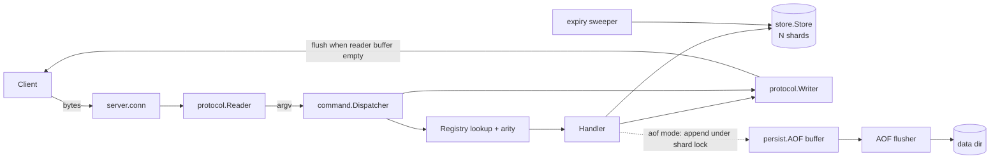

# Architecture

## Components

| Package             | Responsibility                                                                          |
| ------------------- | --------------------------------------------------------------------------------------- |
| `internal/protocol` | RESP2 `Reader` (arrays of bulk strings, inline commands, all RESP2 types) and `Writer`  |
| `internal/store`    | Sharded typed keyspace: values, expiry index and sweeper, `Clock`, `Scan`, glob matcher |
| `internal/list`     | List value: ring-buffer deque                                                           |
| `internal/hash`     | Hash value: insertion-ordered slice plus position map                                   |
| `internal/set`      | Set value: member slice plus position map (O(1) random member)                          |
| `internal/zset`     | Sorted-set value: skip list with spans plus member map                                  |
| `internal/command`  | `Registry`, `Dispatcher`, command handlers, `Context`, `Rewrite` hooks                  |
| `internal/server`   | TCP accept loop, per-connection loop, graceful shutdown                                 |
| `internal/config`   | Defaults, validation, flag/env loading                                                  |
| `internal/persist`  | Durability: manifest, snapshot and log formats, AOF, recovery, checkpoint manager       |
| `cmd/sylphy-server` | Wiring, logging, signals, recovery and shutdown order, sweeper lifecycle                |

Dependencies point inward: `server` → `command` → (`store` via interface, `protocol`).
The value packages import `store` (for `Kind`, `Value`, `Collection`) and
`command` imports them; `store` knows nothing about concrete collection types.
`persist` imports `command` (registry, `Propagator`) and `store`. `cmd/sylphy-server`
wires it to `server` through `command.Persistence` and `command.Propagator`.
`command` depends on a small `Store` interface, so handlers are tested against a
real small store with a fake clock.



## Request lifecycle

1. The connection goroutine arms the idle read deadline (only if the reader
   buffer is empty) and calls `Reader.ReadCommand`.
2. The reader parses a RESP array of bulk strings or an inline line into `argv`.
3. `Dispatcher.Dispatch` looks up the command case-insensitively, checks arity,
   and runs the handler with `argv[1:]`.
4. The handler reads/writes the store and appends its reply to the `Writer`
   buffer. Returned `*ReplyError`s become RESP errors; `store.ErrWrongType`
   becomes `WRONGTYPE`; other errors become `ERR internal error` and are logged.
5. In `aof` mode a write command goes through the journal: before the handler
   it is refused with `MISCONF` if persistence has failed, then waits for room in
   the log (`Admit`); inside the handler's critical section its deterministic
   form is appended to the log (see [Persistence](#persistence) and
   [ADR-018](DESIGN_DECISIONS.md#adr-018-rewrite-hooks-for-a-future-append-only-log),
   [ADR-020](DESIGN_DECISIONS.md#adr-020-logging-under-the-shard-lock-through-a-journaling-store)).
6. If `Reader.Buffered() == 0` the writer is flushed — one syscall for a whole
   pipelined batch. Otherwise the loop continues with the next buffered request.
   With `aof` and `append-fsync always` the reply to a write is held until its
   log record is durable.
7. Protocol/limit errors write `-ERR Protocol error: ...`, flush, and close the
   connection. `QUIT` flushes and closes.

## Value model

```text
store.Value        Kind() Kind                      string, list, hash, set, zset
store.Collection   Value + Len() int                list, hash, set, zset
```

A key maps to one `Value`. Handlers never hold a collection outside a closure:
`View` (read lock), `Mutate` (write lock, returns the new value), `MutateEntry`
(write lock plus TTL access) and `Atomic`/`AtomicView` (several keys) run the
handler's function under the shard lock. Returning `nil` or an emptied
`Collection` from `Mutate`, or calling `Entry.Put` with one, deletes the key and
its TTL. A wrong-kind value yields `store.ErrWrongType`, which the dispatcher
turns into `WRONGTYPE`. See [ADR-010](DESIGN_DECISIONS.md#adr-010-typed-values-and-closure-based-access).

Handlers copy what they need out of the closure and write their reply after it
returns, so a slow client can never hold a shard lock.

| Value  | Structure                                 | Why                                                                                                      |
| ------ | ----------------------------------------- | -------------------------------------------------------------------------------------------------------- |
| string | `[]byte`                                  | binary-safe, copied in and out                                                                           |
| list   | ring-buffer deque                         | O(1) both ends and by index ([ADR-013](DESIGN_DECISIONS.md#adr-013-ring-buffer-lists))                   |
| hash   | entry slice + `map[field]position`        | O(1) ops, deterministic order                                                                            |
| set    | member slice + `map[member]position`      | O(1) uniformly random member for `SPOP`/`SRANDMEMBER`                                                    |
| zset   | skip list with spans + `map[member]score` | O(log n) rank/range/insert ([ADR-014](DESIGN_DECISIONS.md#adr-014-skip-list-with-spans-for-sorted-sets)) |

## Expiry subsystem

Deadlines are absolute Unix milliseconds. Each shard has an `exp` index
(`key → deadline`, always a subset of the shard's keys) next to its value map.

- **Lazy expiry.** Every access compares the key's deadline with the store clock.
  A read path that finds an expired key reaps it under the write lock and then
  reads again; `Delete`, `Exists`, `Len`, `Keys`, `Scan` and `AtomicView` never
  return expired keys. A deadline equal to "now" is still alive.
- **Active expiry.** A sweeper goroutine, started by `Store.Start`, wakes every
  `TickInterval` (100 ms). For each shard it samples up to `SampleSize` (20)
  keys from the expiry index and deletes the expired ones; if more than
  `StaleThreshold` (25%) of a sample was expired it samples the same shard
  again. A cycle stops after `CycleBudget` (25 ms) of real time so the sweeper
  never starves writers. Keys nobody reads are therefore reclaimed in bounded
  time, and the share of dead keys stays near the threshold.
- **Counters.** `Store.Stats` reports lazy and active expirations and completed
  sweeper cycles.
- **Time.** All decisions use the injected `Clock`; the sweeper's budget uses
  the real wall clock because it bounds CPU time. See
  [ADR-011](DESIGN_DECISIONS.md#adr-011-expiry-lazy-checks-plus-sampled-active-sweeping)
  and [ADR-012](DESIGN_DECISIONS.md#adr-012-injectable-clock).
- **Persistence.** In `aof` mode a hook logs `DEL key` inside the shard lock for
  each key that expiry removes, and recovery replays the log with the clock
  frozen (see [ADR-022](DESIGN_DECISIONS.md#adr-022-frozen-clock-replay-and-logging-expiry-as-del)).

## Concurrency model

- **One goroutine per connection**, tracked by a `WaitGroup` and a set guarded
  by `Server.mu`. `recover()` at the connection boundary isolates panics.
- **Store**: N shards, each with its own `RWMutex`. Single-key operations hold
  one shard lock. Operations that need several keys (`Atomic`, `AtomicView`:
  `SMOVE`, the `*STORE` set commands, `RENAME`) lock the involved shards in
  **ascending shard-index order**, each shard once, so no cycle of waiting
  goroutines can form ([ADR-015](DESIGN_DECISIONS.md#adr-015-ascending-shard-lock-ordering)).
  The sweeper, `Scan`, `RandomKey`, `Keys` and `Flush` hold one lock at a time;
  `Keys` and `Scan` snapshot names under a shard read lock and filter outside it.
- **Registry** is immutable after startup (lock-free reads).
- **Persistence locks.** Lock order is shard locks (ascending, as above), then
  the AOF mutex. Journaling appends records while shard locks are held, and so
  does the expiry hook, which is why the AOF mutex is a leaf: `Append` only
  copies into a memory buffer and `Rotate` only marks a boundary, and the
  flusher does all file I/O without holding it. `Store.BeginSnapshot` is the
  other multi-shard entry point: it takes every shard in ascending order and
  runs the barrier (`AOF.Rotate`, `AOF.Stats`) under them. Calls that block
  (`Admit`, `WaitDurable`) are made with no lock held. The `Manager` mutex is
  never taken under a shard lock or the AOF mutex; the flusher holds it across
  the manifest commit that lists a new segment, so that callback must never wait
  for a shard lock.
- **Shutdown**: `closing` is set under `mu` before the listener is closed;
  `admit` checks it under the same lock before `wg.Add`, so `Add` never races
  `Wait`. Draining sets a past read deadline on every connection (guarded by a
  per-connection mutex so the idle-timer update can't overwrite it). After the
  grace period remaining sockets are force-closed. `main` closes the store after
  the server has stopped, which stops the sweeper.

## Goroutine ownership

| Goroutine          | Owner                                               | Exits when                                                                                  |
| ------------------ | --------------------------------------------------- | ------------------------------------------------------------------------------------------- |
| accept loop        | `Serve` (waits on it)                               | listener closed                                                                             |
| connection         | `Server.wg`                                         | peer closes, error, drain deadline, force close                                             |
| shutdown waiter    | `Shutdown`                                          | `wg.Wait` returns                                                                           |
| expiry sweeper     | `Store` (`Start`/`Close`)                           | `Store.Close` (waits on it); `Start` after `Close` is a no-op                               |
| AOF flusher        | `persist.AOF`, opened by `Manager.Start` (aof mode) | `AOF.Close`, called last by `Manager.Shutdown`; it writes and fsyncs what is buffered first |
| checkpoint trigger | `Manager`, started by `Start` (aof mode)            | `Manager.Shutdown` closes `quit` and waits for it                                           |
| BGSAVE worker      | `Manager.wg`                                        | it finishes, or `Manager.Shutdown` cancels it (`bgCtx`) and waits                           |
| signal watcher     | `run` in `main`                                     | `done` is closed when `run` returns                                                         |

`Store.Close` is idempotent, safe without `Start`, and leaves the store usable
(without active expiry). Integration tests assert that no goroutine outlives the
server and store. `SAVE` runs on the calling connection's goroutine and takes the
same single checkpoint slot as `BGSAVE`; `Manager.Shutdown` cancels it too.

## SCAN

`SCAN` walks shards in ascending index order and each shard's key slots from
high to low; the cursor packs the shard and the number of unvisited slots, so
the server keeps no iteration state. Cost per call is O(`COUNT` + shards). See
[ADR-016](DESIGN_DECISIONS.md#adr-016-scan-cursor-over-shards-and-key-slots).

## Persistence

Three modes: `off` (nothing on disk), `snapshot` (checkpoints only) and `aof`
(every write logged, plus checkpoints); see
[ADR-027](DESIGN_DECISIONS.md#adr-027-persistence-modes). Formats, configuration
and operations are in [PERSISTENCE.md](PERSISTENCE.md).

**Write path (`aof`).**

1. `journal.begin` runs before a write handler: `MISCONF` if the log has failed,
   then `Admit` blocks, outside any lock, while the log buffer is at or above its
   high-water mark.
2. The handler's closure runs under its shard lock(s), passing the
   [copy-on-write gate](#copy-on-write-gate) first.
3. When the closure succeeds, the journal appends the command's rewrite (or the
   request verbatim) in the same critical section. `AOF.Append` copies the
   records into a memory buffer and assigns sequence numbers; it never blocks
   and does no I/O. `Set`, `Delete` and `Flush` log `SET`, `DEL` (only if the key
   existed) and `FLUSHALL` themselves.
4. The locks are released and the reply goes to the `Writer`. `Context.LastSeq`
   holds the newest sequence this connection appended.
5. The AOF flusher goroutine seals what has been appended, writes it to the
   active segment and fsyncs according to `append-fsync`. Records appended while
   a write or fsync runs form the next batch (group commit).
6. With `always`, the server holds a connection's replies until `WaitDurable`
   says its records are fsynced.

If `Append` fails after the command was applied (the log latched between `Admit`
and `Append`), the change stays in memory: a closure command returns `MISCONF`
instead of its reply and later writes are refused until a checkpoint heals the
log ([ADR-025](DESIGN_DECISIONS.md#adr-025-admit-backpressure-and-the-error-latch)).

### Copy-on-write gate

Go has no `fork`, so a checkpoint takes its point-in-time copy lazily, one shard
at a time ([ADR-021](DESIGN_DECISIONS.md#adr-021-shard-granular-copy-on-write-snapshots)).

1. `Store.BeginSnapshot` locks every shard in ascending order, runs the barrier
   (in `aof` mode the log rotation marker, an in-memory step), marks every shard
   pending and unlocks.
2. After that each shard is serialized once, from its state at step 1, by
   whichever comes first: `Snapshot.Drain` walking the shards under the read
   lock, or the first writer to take that shard's write lock. Every write-lock
   acquisition goes through `lockW`, which serializes a pending shard before the
   writer changes it (a test enforces that no acquisition bypasses it).
   A writer that locks several shards gates all of them first.
3. `Drain` hands each shard's block to the base-file writer in shard order.
   `Snapshot.Close` ends the gating.

A writer that hits a pending shard pays for that shard's serialization under its
lock, and blocks written ahead of `Drain` are held in memory until written.

### Startup and shutdown order

Startup (`serve` in `main.go`):

1. Load config (exit code 2 on error), build the logger, install signal handling
   (the first signal cancels `ctx`, a second cancels `abort`).
2. Create the store (sweeper not started), the registry and the server.
3. With persistence on: build the `Manager` and defer its `Shutdown` (registered
   first, so it runs last). `Recover` loads the base and replays the segments
   with no listener and no sweeper; on failure the process exits with code 1.
   `Start` opens the log at the recovered point, installs the expiry hook, then
   purges keys that expired while the server was down, logging and fsyncing a
   `DEL` for each (in `snapshot` mode the purge is in memory), and starts the
   checkpoint trigger (`aof`). Then `SetPersistence` hands the server the
   commands, the propagator and the hold-replies-until-durable flag
   (`aof` and `always`).
4. `Store.Start` starts the sweeper; `Store.Close` is deferred.
5. Listen, then `Serve`.

Shutdown runs in the opposite order:

1. The first SIGINT/SIGTERM cancels `ctx`; `Serve` stops accepting and drains
   clients within `ShutdownGracePeriod`.
2. `Store.Close` stops the sweeper, so it never appends to a closed log.
3. `Manager.Shutdown(abort)`: stop the checkpoint trigger, cancel and wait for a
   running checkpoint, take the final checkpoint (when `snapshot-on-shutdown`
   resolves to on and `abort` is not cancelled), detach the expiry hook, then
   `AOF.Close` writes and fsyncs what is buffered (30 s limit). A failure makes
   the exit code 1.
4. A second signal cancels `abort`: the final checkpoint is skipped, the log is
   still flushed and fsynced. The grace period bounds only client draining; the
   final checkpoint is bounded only by `abort`.

## Hooks for later phases

- `Spec.Rewrite` (ADR-018) is now consumed by the
  journal ([ADR-028](DESIGN_DECISIONS.md#adr-028-rewrite-hooks-consumed-inside-the-critical-section)).
  `Context.EnableJournal`, `LastSeq` and `JournalErr` are the connection-side
  surface of persistence.
- Future work, Phase 4: transaction and subscription state goes in `Context` and
  `ConnState`; handlers only ever see `*Context`.
- Future work, Phase 5: replication is meant to implement `command.Propagator`,
  the interface `*persist.AOF` implements today.
- Future work: `INFO` can reuse `AOF.Stats`, `Manager.Err` and `LastSave`.
