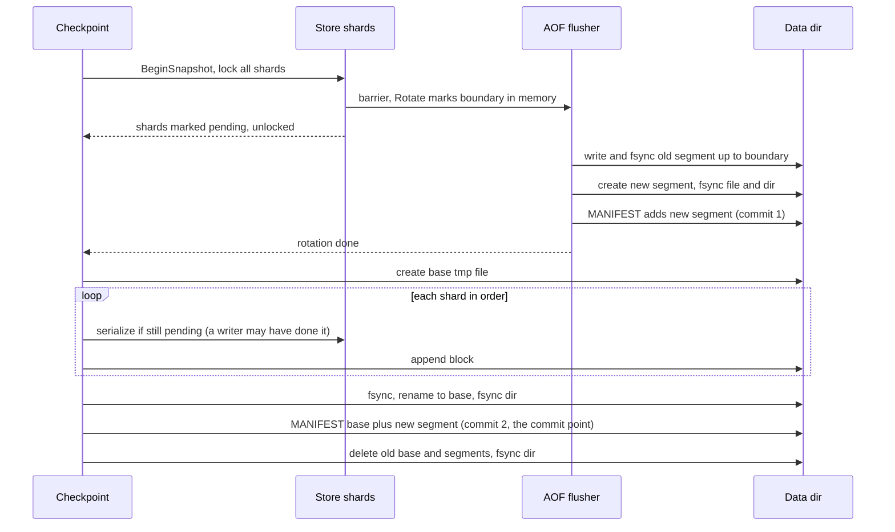

# Persistence

Sylphy keeps the whole dataset in memory. Persistence is optional and has three modes.

| Mode | What is written | What a crash (SIGKILL, power loss) loses |
|---|---|---|
| `off` (default) | Nothing. The data directory is never read or written. | Everything. |
| `snapshot` | A checkpoint (base snapshot) on `SAVE`, `BGSAVE` and at shutdown. No log, no automatic trigger. | Everything since the last checkpoint. |
| `aof` | Every write is logged to an append-only log, plus checkpoints (manual, automatic, shutdown). | Depends on `append-fsync` (see [Fsync policies](#fsync-policies-and-loss-windows)). |

A graceful shutdown (SIGINT/SIGTERM) takes a final checkpoint when `snapshot-on-shutdown` resolves to on. A second signal skips the checkpoint, but the log is still flushed and fsynced.

## Configuration

Precedence: defaults, then `SYLPHY_*` environment variables, then flags (flags win). An empty environment variable is ignored. All problems are reported together and the process exits with code 2.

| Flag | Env var | Default | Notes |
|---|---|---|---|
| `-persistence-mode` | `SYLPHY_PERSISTENCE_MODE` | `off` | `off`, `snapshot` or `aof`. |
| `-dir` | `SYLPHY_DIR` | `./data` | Must be non-empty when persistence is on. The Docker image sets `/data`. |
| `-append-fsync` | `SYLPHY_APPEND_FSYNC` | `everysec` | `always`, `everysec` or `no`. Only acted on in `aof` mode, but an invalid value is rejected in every mode. |
| `-auto-rewrite-percentage` | `SYLPHY_AUTO_REWRITE_PERCENTAGE` | `100` | Checkpoint when the log has grown by this percent over the base size. `0` disables the trigger. `aof` mode only. |
| `-auto-rewrite-min-size` | `SYLPHY_AUTO_REWRITE_MIN_SIZE` | `64m` (64 MiB) | Smallest base plus log size, in bytes, at which the trigger may fire. Plain integer or suffix `b`, `k`, `kb`, `kib`, `m`, `mb`, `mib`, `g`, `gb`, `gib` (case-insensitive, all powers of 1024). |
| `-aof-load-truncated` | `SYLPHY_AOF_LOAD_TRUNCATED` | `true` | Repair a partial last record at startup instead of refusing to start. Env value is parsed with Go's `ParseBool`. |
| `-snapshot-on-shutdown` | `SYLPHY_SNAPSHOT_ON_SHUTDOWN` | `auto` | `auto` means on whenever persistence is on. `true` with `off` mode is a config error. |

The snapshot and log formats do not depend on the shard count, so `-shards` may change between runs.

Docker: persistence stays off unless `SYLPHY_PERSISTENCE_MODE` is set. The image runs as uid 65532 (`nonroot`) with `/data` owned by that user, for example:

```
docker run -v sylphy-data:/data -e SYLPHY_PERSISTENCE_MODE=aof ...
```

### Commands

These are admin commands. They are never logged and keep working while the log is in its error state.

| Command | Reply |
|---|---|
| `SAVE` | `OK` after the checkpoint is committed. Blocks only the calling connection. |
| `BGSAVE` | `Background saving started` |
| `BGREWRITEAOF` | `Background append only file rewriting started`. Same checkpoint as `BGSAVE`. |
| `LASTSAVE` | Unix seconds of the last checkpoint, or of process start if there has been none in this process. `0` when persistence is off. |

Errors:

- Persistence off: `ERR persistence is disabled; start the server with -persistence-mode snapshot or aof`.
- `BGREWRITEAOF` in `snapshot` mode: `ERR the append-only file is not enabled; start the server with -persistence-mode aof`.
- A checkpoint is already running: `ERR Background save already in progress` (for `BGREWRITEAOF`: `ERR Background append only file rewriting already in progress`).

## Data directory

```
MANIFEST              commit point: which files make up the database
MANIFEST.tmp          a new manifest before its rename (garbage if it survives a crash)
base-NNNNNN.snap      at most one base snapshot
seg-NNNNNN.aof        zero or more log segments (aof mode)
*.tmp                 a file still being written (e.g. base-NNNNNN.snap.tmp)
```

- Ids are zero-padded to six digits. Base and segment ids are numbered independently.
- The database is the base plus the listed segments, replayed in manifest order.
- Only the manifest decides what is valid. Recovery deletes every `*.tmp` file and every `base-*`/`seg-*` file the manifest does not list, after a successful recovery.
- Invariants that make that rule safe:
  - A segment is listed before it receives a record.
  - A base is durable under its final name before any manifest names it.
  - Files are created with mode 0644 and the directory with 0755.
- Segments are plain RESP, so existing RESP tools can read them.

Illustration, aof mode on an empty directory:

- First start: `MANIFEST` (generation 1) and `seg-000001.aof`.
- After the first checkpoint: `MANIFEST` (generation 3), `base-000001.snap` and `seg-000002.aof`. `seg-000001.aof` is retired.

## On-disk formats

All checksums are CRC-32C (Castagnoli). Snapshot integers are little-endian.

### MANIFEST (text, newline-terminated lines)

| Line | Form | Notes |
|---|---|---|
| 1 | `SYLPHY-MANIFEST 1` | Magic and format version. |
| 2 | `generation <decimal>` | Increases with each committed manifest: +1 for the rotation listing in aof mode, +1 for the checkpoint commit. |
| 3 (optional) | `base <name> <size> <crc>` | Name is `base-%06d.snap`, size is decimal bytes, crc is 8 lowercase hex digits (the snapshot's whole-file CRC). Must come first after `generation`. |
| next, 0 or more | `segment <name>` | Name is `seg-%06d.aof`. Ids must be strictly increasing; the order is the replay order. |
| last | `crc <8 hex>` | CRC of every preceding byte. |

- Numbers are canonical, so a decoded manifest re-encodes to identical bytes.
- Names must be exactly the canonical spelling, so a manifest cannot point outside the directory.
- The checksum is verified before anything else is interpreted.

Illustrative content (not a real file):

```
SYLPHY-MANIFEST 1
generation 3
base base-000001.snap 123456 0a1b2c3d
segment seg-000002.aof
crc 89abcdef
```

### Snapshot (`base-NNNNNN.snap`)

`file = header block* end`

Header, 20 bytes:

| Offset | Size | Field | Value |
|---|---|---|---|
| 0 | 8 | magic | `SYLPHYSN` |
| 8 | 2 | version | `1` |
| 10 | 2 | flags | `0` (must be zero) |
| 12 | 4 | reserved | `0` (must be zero) |
| 16 | 4 | CRC | of bytes 0..15 |

Block, 13 bytes of framing plus payload:

| Offset | Size | Field | Notes |
|---|---|---|---|
| 0 | 1 | tag | `0x01` |
| 1 | 4 | count | Entries in the payload, at least 1. |
| 5 | 4 | length | Payload bytes, at most 1 GiB (`MaxBlockPayload`). |
| 9 | n | payload | `count` entries back to back. |
| 9+n | 4 | CRC | Of tag, count, length and payload. |

A block is closed once its payload reaches 256 KiB. Each shard's data is framed separately, so blocks never span shards.

End record, 17 bytes:

| Offset | Size | Field | Notes |
|---|---|---|---|
| 0 | 1 | tag | `0xFF` |
| 1 | 8 | entries | Total entries in the file. |
| 9 | 4 | blocks | Total blocks in the file. |
| 13 | 4 | CRC | Of every byte of the file before this field. This is the value stored in the manifest. |

The file ends right after the end record.

Entry:

| Field | Encoding |
|---|---|
| type | 1 byte: 1 string, 2 list, 3 hash, 4 set, 5 zset |
| flags | 1 byte: bit 0 = has deadline, other bits must be 0 |
| key | uvarint length, then bytes |
| deadline | 8 bytes, absolute Unix ms as int64, present only if flags bit 0, must be > 0 |
| payload | by type, below |

Payload by type (an element, field, value or member is a uvarint length plus bytes):

| Type | Payload |
|---|---|
| string | one value |
| list | uvarint n >= 1, then n elements, head to tail |
| hash | uvarint n >= 1, then n (field, value) pairs |
| set | uvarint n >= 1, then n members |
| zset | uvarint n >= 1, then n (score, member) pairs in ascending rank. A score is 8 bytes, the IEEE-754 bits of the float64, so -0 and the infinities round-trip exactly. |

Rejected as corrupt: empty collections, duplicate fields or members, NaN scores, non-positive deadlines, unknown tags, types or flags, trailing data, and count mismatches. Decoders verify each block's CRC before decoding it. Memory use follows the bytes actually present, not the lengths claimed.

### AOF segment

A segment is a sequence of records. Each record is one command as a RESP array of bulk strings:

| Part | Encoding |
|---|---|
| array header | `*<n>\r\n`, n >= 1 |
| each argument | `$<len>\r\n<bytes>\r\n` |

- Decimals are canonical (no leading zeros, at most 18 digits).
- Defaults: at most 1,048,576 arguments per record and 512 MiB per argument.
- No inline commands, no null bulks, no empty arrays.
- **Records have no checksum.** They are validated only by parsing. A record that decodes re-encodes to the same bytes.

## Checkpoint

One procedure serves `SAVE`, `BGSAVE`, `BGREWRITEAOF`, the automatic trigger and the shutdown checkpoint. A new base plus a fresh segment is both a snapshot and a log rewrite. Only one checkpoint runs at a time. In `snapshot` mode there is no log, so step 1 has no rotation and the manifest never lists segments.



### 1. Barrier and rotation

`BeginSnapshot` takes every shard lock in ascending order and runs the barrier. In aof mode the barrier calls `AOF.Rotate()`, which only seals the in-memory buffer at that point in the record stream. No I/O happens under the locks. It then marks every shard pending and unlocks. The pause is O(shards).

The checkpoint then waits for the flusher outside the locks. Rotation order inside the flusher:

1. Write and fsync the old segment up to the boundary, whatever the fsync policy.
2. Create the new segment (`O_EXCL`), fsync it, fsync the directory.
3. Commit a manifest that lists the new segment and keeps the old base and old segments.
4. Switch to the new segment.

Crash safety:

- Before step 3 the manifest does not know the new segment. It is garbage and recovery deletes it. The old segments are complete up to the boundary.
- After step 3 the manifest lists the old base, the old segments and the new segment. Replaying them reproduces the full state.
- Records after the boundary are written only after the rotation chunk, so the new segment is listed before it receives a record.

### 2. Copy-on-write gate

From the barrier on, each shard is serialized exactly once, from its state at the barrier, under that shard's lock. Whichever comes first does it:

- the drain walking the shards in order, or
- the first writer to take that shard's write lock, which serializes the shard before applying its own change.

A writer touching several shards (`Atomic`) gates all of them first, so a multi-key command is wholly in or wholly out of the snapshot.

Crash safety: nothing is durable yet. Every write after the barrier goes into the new segment. Base (state at the barrier) plus new segment is therefore the full state, whichever party serialized a shard.

### 3. Base write

The drain hands blocks to the base writer in shard order. The sequence is:

1. Write `base-N.snap.tmp`, ending with the end record.
2. fsync the file.
3. Rename it to `base-N.snap`.
4. fsync the directory.

Crash safety:

- A `.tmp` file is never part of a committed state.
- The final name appears only after the contents are durable.
- The directory is synced before any manifest refers to the file, so a manifest can never name a file that a crash made disappear.
- Until the manifest commit the base is unlisted and is deleted at recovery.
- On a write error the tmp file (and a renamed file) is removed.

### 4. Manifest commit

The new manifest is `{generation+1, base, [new segment]}` (no segments in snapshot mode). The commit sequence is:

1. Write `MANIFEST.tmp` and fsync it.
2. Rename it over `MANIFEST`.
3. fsync the directory.

The rename is the commit point.

Crash safety:

- Before the rename the previous manifest is intact. Nothing has been deleted, so it still resolves.
- After the rename the new manifest names a durable base and a durable segment holding everything after the barrier.
- If only the final directory sync fails, the new manifest may or may not survive a crash. The checkpoint is reported as failed and the old files are kept, so either outcome is a consistent state.

### 5. Retiring old files

The old base and the old segments (all except the new one) are deleted, then the directory is synced. If the log was latched, `ClearError` runs first (see [Error latch](#error-latch-misconf-and-admit)).

Crash safety: a failure or crash here is harmless, because recovery deletes unlisted files. A deletion failure is only logged.

### Failure handling

- A failed checkpoint is logged (`checkpoint failed`). The automatic trigger then waits 10 one-second ticks before trying again.
- A failed checkpoint after a healthy rotation leaves the new segment listed. Nothing is lost.
- The automatic trigger runs once per second in aof mode and starts a checkpoint when either:
  - the log has grown at least `auto-rewrite-percentage` percent over the base (a missing base counts as 1 byte) and base plus log has reached `auto-rewrite-min-size`, or
  - the log is in its error state.

## Write path (aof mode)

1. **Admit.** Before each write command the journal checks `Err()` and then calls `Admit`. If the log is latched, or `Admit` fails, the client gets `MISCONF` (see [below](#error-latch-misconf-and-admit)). `Admit` blocks outside any lock while the buffered bytes are at or above the high-water mark (32 MiB, fixed; there is no flag for it).
2. **Journaling under the shard lock.** The handler runs inside its shard critical section. After it succeeds, the command's deterministic form is appended inside that same critical section. A record therefore cannot slip between "applied" and "logged", and log order equals apply order per key.
   - A command is logged as its rewrite or the request verbatim.
   - `SET` logs `SET key value`.
   - `DEL` logs one `DEL key` per key that existed.
   - `FLUSHALL` logs `FLUSHALL`.
   - `MSET` logs one `SET` per pair.
   - Records of one command are appended as one contiguous group.
3. **AOF buffer.** `Append` copies the records into an in-memory buffer and assigns sequence numbers under the AOF mutex. It never blocks and does no I/O.
4. **Flusher.** One goroutine, woken by every `Append`, seals the buffer into a batch and writes it to the active segment.
   - A failed or short write is cut back to the last complete write, so no torn record stays mid-log.
5. **Group commit.** The flusher takes everything appended since its last cycle as one batch, so concurrent writers share one write and one fsync.
6. **Replies held until durable.** Under `always` the server is configured to acknowledge a write only after `WaitDurable` returns for its record. `WaitDurable(seq)` returns once that sequence is fsynced.

Expiry is logged as well. When the store expires a key, a hook appends `DEL key` inside the shard lock, at the key's own place in the log. Admin commands (`SAVE`, ...) are never logged.

## Recovery

Recovery runs before the listener and the expiry sweeper start. Startup order: recover, start persistence (open the log, install the expiry hook, purge), start the sweeper, listen.

1. **Manifest.**
   - No manifest and an empty directory: commit an empty manifest and start empty (`no data found: starting empty`).
   - Data files but no manifest: refuse to start.
2. **Frozen clock.** The store clock is frozen at 0 for the whole load and replay. Nothing expires and no deadline deletes a key, so replay reproduces the original sequence regardless of how long the server was down.
3. **Base load.**
   - The file size must equal the manifest's size.
   - The header, every block CRC and the end record are verified.
   - The whole-file CRC must equal the manifest's CRC.
   - Expired entries are loaded as they are.
4. **Segment replay.**
   - Segments are replayed in manifest order through the normal command dispatcher.
   - The loader client uses the raw store, does not propagate to the log, and discards replies.
   - An error reply fails the replay.
5. **Truncated-tail repair.**
   - Only the last segment is eligible, and only when the stream ends in the middle of a record (`ErrTruncated`).
   - With `aof-load-truncated=true` the partial record is cut off at its start, the file is fsynced, and recovery logs `truncated a partial record at the end of the last segment` with segment, offset and bytes.
   - With `false`, startup fails.
6. **Garbage.** `*.tmp` files and unlisted `base-*`/`seg-*` files are deleted. New file ids start above every id ever seen, including the deleted files.
7. **Purge after recover.** Recovery does not purge expired keys. After the log is reopened and the expiry hook is installed, `Start` purges the keys that expired while the server was down.
   - In aof mode each purged key is logged as `DEL` and fsynced before `Start` returns, and so before any client is served. Otherwise a later write to such a key would replay on top of the stale copy still stored in the base.
   - In snapshot mode the purge is in memory only.

### Hard errors

The server logs `recovery failed; refusing to start so the data directory is left untouched` and exits with code 1. The causes are:

- Manifest checksum, format or version error, or data files without a manifest.
- A listed file is missing.
- Base size or CRC mismatch, or any damage in the base (including trailing data).
- Damage or truncation in any segment other than the tail of the last one.
- Unparsable bytes in the last segment, including a zero-filled tail. A zero-filled tail is corrupt, not truncated.
- A replayed command that returns an error.
- A partial last record with `aof-load-truncated=false`.
- Snapshot or manifest format version newer than this build.

Errors name the file and, when known, the byte offset.

## Fsync policies and loss windows

Applies to `aof` mode. The flusher fsyncs according to the policy.

| Policy | When the flusher fsyncs | What a crash loses |
|---|---|---|
| `always` | After every flusher batch. Replies are held until their record is durable. One fsync covers every record appended while the previous one ran. | Nothing that was acknowledged, provided the disk and file system honor fsync. |
| `everysec` (default) | Once per second, if anything was written since the last fsync. | About one second of acknowledged writes on an OS or power crash (a little more on a slow disk). A process kill alone loses at most what was still in the in-memory buffer, since the flusher writes on every wake. |
| `no` | Never on its own. | Whatever the OS had not flushed. Rotation, close and an explicit `WaitDurable` still fsync. |

Snapshot mode loses everything since the last checkpoint. A graceful shutdown still takes the final checkpoint. Records accepted by a latched log but never persisted are lost, and counted and logged.

## Error latch, MISCONF and Admit

- A failed write or fsync **latches** the log. From then on `Append`, `Admit` and `WaitDurable` fail. The flusher never retries a failed fsync, since the kernel may already have dropped the dirty pages.
- Records accepted but never written are dropped, and logged as `records dropped: not written because the AOF is in an error state`.
- Every write command is refused with this reply. Reads and admin commands keep working.

```
MISCONF Sylphy is unable to persist writes to disk, so commands that may modify the data set are disabled. Check the server logs for details.
```

- The same `MISCONF` reply is sent when `Admit` fails for any reason, including a cancelled connection or a closed log.
- **Command already applied.** If the log latches between `Admit` and `Append`, the change is already in memory. Closure-style commands return `MISCONF` instead of their normal reply. A key changed by `Update` is left untouched. In-place `Mutate` and `MutateEntry` changes stay in memory. Memory and log differ until a checkpoint. If the process dies first, the change is lost like any non-durable write.
- **Healing.** A checkpoint taken while latched (manual, or automatic: the trigger fires whenever the log is latched):
  1. abandons the untrusted old segment and starts a fresh one without listing it;
  2. writes a new base from memory;
  3. commits the manifest;
  4. clears the latch.

  The log then logs `persistence recovered: writes are accepted again`.
- If another failure happens during the checkpoint, the latch stays and the next checkpoint tries again.
- **Backpressure.** `Admit` blocks while buffered bytes are at or above the high-water mark. The bound is soft: `Append` never blocks, so it can be exceeded by writes already admitted.

## Limitations

- No checksum on AOF records. Corruption inside a bulk payload that still parses is not detected.
- A zero-filled or otherwise garbled tail is a hard error, not repaired, even with `aof-load-truncated=true`.
- No directory lock. Nothing in the code prevents two servers from sharing one `-dir`.
- The backpressure high-water mark (32 MiB) is not configurable.
- One entry larger than the 1 GiB block limit cannot be snapshotted. Every checkpoint then fails.
- Writers that reach a pending shard serialize it under its write lock, so that write pays for the shard's serialization. Blocks serialized ahead of the drain are held in memory until written, so memory can approach the encoded size of the dataset.
- The automatic trigger exists only in aof mode. In snapshot mode checkpoints happen only on `SAVE`, `BGSAVE` and shutdown.
- On Windows `SyncDir` is a no-op, so directory-entry durability (the manifest rename) is not guaranteed there.
- Replay goes through the current command set. A command that errors on replay stops startup.
- No transactions, replication or `INFO` yet. The command journal's `Propagator` interface is the hook replication is planned to reuse in a later phase (future work).

## Operations

### Backup

There is no hot-backup mechanism. A checkpoint can retire files while they are being copied. Stop the server gracefully (the final checkpoint leaves a base plus an empty segment), copy the whole directory including `MANIFEST`, then restart. A restore without `MANIFEST` is refused if data files are present.

### Full disk

- In aof mode a failed write or fsync latches the log and writes get `MISCONF`.
- Free space. The automatic trigger retries, 10 ticks after each failure, and healing needs room for a complete new base next to the old files. Or run `SAVE`, `BGSAVE` or `BGREWRITEAOF` yourself.
- In snapshot mode a failed checkpoint is only logged, and nothing is latched. A failed final checkpoint at shutdown makes the process exit with code 1.

### Upgrades and mode changes

- A manifest or snapshot with a newer format version is refused. There is no migration or downgrade path. Back up before upgrading.
- `snapshot` to `aof`: works. A segment is created and listed at start.
- `aof` to `snapshot`: existing segments are replayed at the next start. The next checkpoint drops them, and until then new writes are not logged.
- `off`: the directory is neither read nor written. Switching `off` back to a persistent mode later loads whatever was last there.

### Manual kill-and-recover walkthrough

1. Start with the log fully synced:

   ```
   sylphy-server -persistence-mode aof -append-fsync always -dir /tmp/sylphy-demo
   ```

2. In another terminal (default address `127.0.0.1:6380`):

   ```
   redis-cli -p 6380 SET greeting hello
   redis-cli -p 6380 SET counter 1
   ```

3. Kill the server without a graceful shutdown:

   ```
   kill -9 <pid>
   ```

4. Restart with the same flags and read back:

   ```
   redis-cli -p 6380 GET greeting
   ```

   Expect `hello`. The log shows `recovering` and then `recovery complete` with `base_keys=0`, `segments=1` and `records` equal to the number of logged writes.

5. Take a checkpoint and inspect the directory:

   ```
   redis-cli -p 6380 SAVE
   ls /tmp/sylphy-demo
   ```

   Expect `MANIFEST`, `base-000001.snap` and `seg-000002.aof` (the first segment is retired). `cat MANIFEST` shows `generation 3`, a `base` line and a `segment` line.

6. Torn tail. Stop the server, then append a partial record:

   ```
   printf '*3\r\n$3\r\nSET\r\n$1\r\nk' >> /tmp/sylphy-demo/seg-000002.aof
   ```

   Start again. Recovery logs `truncated a partial record at the end of the last segment` with `bytes=18`, and starts normally.

7. Repeat step 6 and start with `-aof-load-truncated=false`. Startup fails with an error naming the segment, the offset and `aof-load-truncated is false`.
